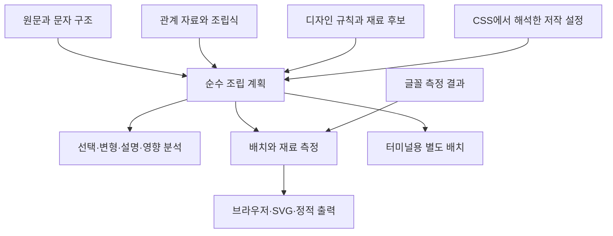

# ADR-032: 옛한글과 다양한 표현 재료를 위한 한글 구조·조립 설계

## Status

Proposed / 구현 진행 (2026-10-18). 사용자의 옛한글 확장, 영문·숫자·기호로 한글 만들기 요구를 반영한다. 사용자 후속 요청으로 H0·H3a–d의 첫 범위를 구현해 2026-10-18 master 로컬 병합했다(`e92249e`, 병합 전 결정은 사용자 위임으로 에이전트가 정함). 실제 계약과 검증 범위는 §12 및 기능 보존 원장에 기록한다. H1 이후 문자 구조 분석·전체 계획·옛한글 렌더링은 후속 설계다. 공개 승인은 별도다.

이 설계는 [ADR-025](ADR-025-hangul-composition-design.md)의 조립 해석기, [ADR-030](ADR-030-one-engine-glyph-shapes.md)의 공통 모양·편집 체계, [ADR-031](ADR-031-explicit-options-and-review-evidence.md)의 설정·검수 근거를 확장한다. 구현 순서는 [PLAN-HANGUL-001](../PLAN/hangul-composition-refactor.md)의 확장 단계 H에 둔다.

2026-10-18: 나누기 × 조각 깊이를 하나로 고르는 짓는 방식 프리셋은 [ADR-034](ADR-034-composition-modes.md)다. 조각 깊이 자료(`levels`)는 옛자모 조립식을 받게 두고(§2.2·§2.3), 옛한글 묶음에는 H6 전까지 적용하지 않는다.

## 1. 목표와 핵심 선택

한글의 문자 구조를 해석하고, 그 구조를 여러 방법으로 조립하고, 각 조각에 원하는 재료를 배정한다. 현재의 한글 폰트·그림 자소·원소 획과 앞으로의 영문·숫자·기호가 같은 조립 계획을 쓴다. 옛한글도 이 경로를 쓰며, 현대 한글 전용 상수는 현대 한글 처리 구간 안에 둔다.

예를 들어 `이`는 문자 구조에서 초성 ㅇ과 중성 ㅣ다. 표현은 `O`와 `|`, `0`과 `l`, 그림 고리와 실제 한글 폰트 ㅣ를 섞을 수 있다. 재료를 바꿔도 한글로 선택·복사·검색·읽기 지원을 제공한다. `O|`라는 문자열 자체를 얻는 기능은 별도 내보내기다.

| 구별할 것 | 책임 | 예 |
|---|---|---|
| 문자 구조 | 어떤 문자·역할·순서인지, 원문과 어떻게 대응하는지 | 회 → 초성 ᄒ, 중성 ᅬ |
| 관계 자료 | 문자 결합, 제자 설명, 그림 재사용, 획순의 관계와 근거 | ㅚ의 구성 설명과 ㅎ의 그림 조립법은 서로 다른 관계 |
| 조립 계획 | 무엇을 통째로 쓰고 무엇을 나누며 어떤 조립식을 적용할지 | 회 → ㅎ + ㅗ + ㅣ, 또는 호 + ㅣ |
| 표현 재료 | 각 부분을 실제로 무엇으로 나타낼지 | ㅇ → O, ㅣ → l, 가로획 → − |
| 배치·그리기 | 크기·정렬·접합·칠·측정과 실제 출력 | O의 잉크 상자를 ㅇ의 목표 상자에 맞춤 |

용어는 [용어집](../GLOSSARY.md)의 계획 항목을 따른다. **표현 재료**는 기존 재료를 통틀어 설명하는 말이며 새 face·material 값이 아니다. 영문·기호 표현도 기존 `source.kind: font` / `face: device` / `--fy-material: system` 계열의 확장으로 도입한다.

위 이름은 설계 설명을 위한 구분이다. 사용자에게 이 다섯 층을 모두 설정하도록 요구하지 않는다. 작업실에서는 기존 글꼴을 고르고 재료를 바꾸거나 준비된 제작 방식을 고르는 흐름을 유지한다.

## 2. 문자 구조: 현대 한글은 빠르게, 옛한글은 손실 없이

### 2.1 원문과 해석 결과를 함께 보존

문서 원문, 분석에 쓰는 정규화된 보기, 두 보기 사이의 범위 대응을 분리한다. NFC/NFD가 같은 현대 음절은 같은 의미 구조를 얻지만 원래 문자열까지 덮어쓰지 않는다. UTF-16 오프셋·코드 포인트 위치·글자 묶음 위치를 구분하고 각 범위는 시작 포함·끝 제외로 명시한다. 여러 원문 코드 포인트가 하나의 분석 문자에 대응하는 경우도 허용한다.

기존 API의 NFC 처리·복사 동작은 호환 어댑터로 유지한다. 새 분석 API는 원문 반환과 정규화 반환을 구분한다. 옛한글·호환 자모를 보존하기 위해 NFKC/NFKD를 자동 적용하지 않는다. 실제 문자 교체는 구조를 바꾼 뒤 재직렬화하고, 재료 교체는 원문을 바꾸지 않는다.

### 2.2 역할은 고정, 역할 안의 수는 가변

Unicode는 첫가끝 자모로 현대·옛한글 음절을 나타내며, 초성·중성·종성 각각에 자모의 연속이 올 수 있도록 정의한다. 현대 완성형의 산술 조합·분해는 그중 한 경우다. 이를 모델의 근거로 삼는다. [Unicode 17 §3.12](https://www.unicode.org/versions/Unicode17.0.0/core-spec/chapter-3/)

개념 자료형은 다음과 같다. JSON 스키마나 공개 타입의 확정안은 아니다.

```ts
type HangulUnit = {
  id: string;                    // 문서 안의 식별자
  sourceRanges: SourceRange[];    // 원문과의 대응
  initial: Component[];
  medial: Component[];
  final: Component[];
  marks: Mark[];                  // 방점 등; 받침으로 넣지 않음
  state: 'complete' | 'incomplete' | 'unresolved';
};

type Component = {
  id: string;
  codePoints: number[];           // 내부 정규화 표현; 저작 입력은 jamo와 role
  role: 'initial' | 'medial' | 'final' | 'unknown';
  sourceRanges: SourceRange[];
  filler: boolean;
};
```

문자 하나로 부호화된 복합 자모와 여러 자모의 연속을 저장 단계에서 합치지 않는다. 구성 요소를 더 세분하는 것은 관계 자료의 별도 보기다. 그 분해를 Unicode 정규 분해라고 부르지 않는다. 원문에 없는 채움 문자를 표시 준비에 사용하더라도 가상 요소임을 기록하고 원문에 자동 삽입하지 않는다.

위 자료형은 한글 단위의 핵심만 보인다. 상위 텍스트 모델은 줄·공백·일반 문자·역할 미확정 자모도 별도 단위로 보존한다. 역할이 불명확한 ㄱ을 `initial` 배열에 임시로 밀어 넣지 않으며, 원문의 영문 `O`는 일반 문자로 남는다. 코드 포인트 배열의 순서와 원문 범위는 의미 분석 뒤에도 추적할 수 있어야 한다.

현대 음절은 기존 19×21×28 계산을 빠른 경로로 사용한다. 나머지는 판을 고정한 Unicode 속성과 분절 규칙으로 읽는다. 초성 수·중성 수·종성 수를 각각 1로 제한하거나, 모든 자모의 키 길이를 UTF-16 한 칸으로 제한하거나, 현대의 짜임 9개를 전 한글의 분류로 쓰지 않는다.

사람과 AI가 적는 규칙은 기존처럼 `{ jamo: "ㅇ", role: "initial" }`을 기본으로 한다. 역할 없는 현대 자모 규칙의 현재 일치 의미도 유지한다. 내부에서 역할을 붙여 정규화하며, 호환 자모 하나를 범용 내부 ID로 쓰지 않는다는 원칙을 저작 문법의 제한으로 바꾸지 않는다. 옛자모도 보이는 첫가끝 문자를 직접 적을 수 있고, 코드 포인트 표기는 눈으로 구별하기 어렵거나 호환 자모가 없는 입력의 선택적 표기다. 모호한 입력은 후보 역할을 보여 주며 추측해서 저장하지 않는다.

### 2.3 옛한글 지원의 단계를 분리

첫가끝 확장 자모, 초성·중성 채움 문자, 방점을 모델이 보존한다. 호환 자모 `ㄱ`은 문맥·명시적 입력 정책 없이 초성/종성으로 확정하지 않는다. 자모 블록과 확장 블록·채움 문자·호환 자모의 구분은 [Unicode 17 §18.6](https://www.unicode.org/versions/Unicode17.0.0/core-spec/chapter-18/)을 따른다. 글자 묶음 경계는 [UAX #29, Unicode 17](https://www.unicode.org/reports/tr29/tr29-47.html)의 규칙을 기준으로 한다.

지원 여부는 한 개의 `oldHangul: true`가 아니라 **분석 / 조립식 / 배치 / 재료 / 출력기**별 결과와 이유로 반환한다. 예를 들어 `ᄒᆞᆫ`을 초성·아래아·받침으로 분석할 수 있어도 해당 글꼴에 아래아 배치나 그림이 없을 수 있다. 이 경우 원문 전체를 기기 글꼴에 맡기거나 미지원 표시를 내며, 어느 경로인지 기록한다. 글꼴에 실제로 보이는지는 별도 확인이며 보존 성공을 시각 지원 성공으로 보고하지 않는다.

**H6에서 명시적으로 옛한글 표현을 켜기 전에는 기존 옛한글의 출력·줄바꿈·선택·복사가 같아야 한다.** H1의 새 분석 결과는 부가 정보로 제공하고 기존 symbol 그리기 경로를 바꾸지 않는다. 분석상 한글 단위라는 이유만으로 새 DOM·분절·배치에 투입하지 않는다. 현재 기기 글꼴에 맡기는 `ᄒᆞᆫ`과 방점 표본을 전후 비교한다.

역사적 표기·음가의 타당성을 Unicode 경계만으로 판정하지 않는다. 첫 구현은 명시한 표본과 조립식의 지원부터 넓힌다. 교육·문헌용 지식은 출처·시기·이설을 가진 자료 꾸러미로 확장한다. 입력기의 키 조합·삭제 정책은 별도이며 문자 결합 자료만 공유한다.

## 3. 관계 자료: 설명과 그림 의존성을 구별

한 개의 `from` 관계로 모든 것을 설명하지 않는다. 다음 관계는 종류·방향·자료 판·근거를 가진다.

| 관계 | 사용하는 곳 | 해서는 안 되는 추론 |
|---|---|---|
| 문자 구성·결합 | 분석, 역할별 선택, 재조합 | 모든 그림을 반드시 같은 조각으로 분해 |
| 제자·역사 설명 | 학습 보기, 원형에서 확장하는 안내 | 역사적 계통을 곧바로 도형 덧셈으로 실행 |
| 그림 조립·재사용 | 조립식, 재료 교체, 영향 분석 | ㅎ을 ㅗ+ㅇ으로 그린다고 문자 구조도 ㅗ+ㅇ으로 변경 |
| 획순·움직임 순서 | 쓰기 안내, 애니메이션 | 화면 도형의 생성 순서를 역사적 획순으로 단정 |

기존 `spec/strokes.json`·`spec/jamo-recipes.json` 자료는 종류별로 명시적으로 대응시킨다. 설명 관계는 순환·여러 해석이 있을 수 있지만, 실행할 조립식은 순환이 없는 유한 계획으로 검증한다. 실제 그리기 의존성과 역방향 참조를 계획에서 얻어 영향 범위와 캐시 무효화에 쓴다.

옛자모·사용자 조립식·재료 팔레트는 이름공간과 판을 가진 선언형 자료로 추가한다. 기본 제공 조립식 이름을 하드코딩한 검증기만으로 확장 여부를 정하지 않는다. 등록 시 대상 역할·필수 조각·지원 연산·기준점 참조·순환을 검사하고, 지원하지 않는 연산은 이유와 함께 거부한다. 자료 안의 임의 코드를 실행하는 플러그인 체계는 도입의 전제 조건이 아니다.

## 4. 공통 조립 계획과 안정된 대응



최종 목표인 계획은 DOM 없이 만들고, 각 노드는 의미 요소 ID 목록, 조립식·조각 경로, 재료 후보 ID, 선택 이유, 의존성을 담는다. 의미 요소 하나가 여러 그림 조각으로 나뉘거나, 그림 하나가 여러 의미 요소를 덮을 수 있다. `호` 한 글리프로 회의 일부를 그려도 초성 ㅎ과 모음 구성 부분의 대응은 남긴다.

역할별 선택은 항상 가능하게 모델링하되, 통짜 글리프의 일부만 칠하거나 움직일 수 있는지는 출력기의 능력으로 알린다. 부분 조작이 불가능하면 통짜를 선택하거나 명시적으로 조각으로 나눈다. 선택 가능하다고 부분 외곽선을 가진 척하지 않는다.

이 전체 계획과 새 분석 모델은 H3 문자 매핑의 선행 조건이 아니다. H3은 기존 `sourceJamo`·`planJamo`·원문 복사 경로에서 시작한다. CSS 어댑터는 현재 계층에서 계산한 저작 값을 순수 해석기에 입력하고, 측정 어댑터는 그 결과를 그린다. CSS를 JSON으로 먼저 옮겨야만 저작할 수 있는 구조로 만들지 않는다.

의미 ID는 선택·편집 대응을 위한 것이며 **씨앗 계산의 입력으로 사용하지 않는다.** 의미 ID는 같은 문서의 재료·깊이 변경에 유지한다. 편집으로 문자가 삽입·삭제되면 편집 기록에서 ID를 이어 붙이고, 외부에서 전체 문자열만 다시 받으면 이전 대응의 유지 여부를 표시한다. 코드 포인트 인덱스나 내용 해시만으로 중복 글자들의 영구 ID를 만들지 않는다. 렌더 노드 ID·조각 경로는 조립식 변경에 따라 달라질 수 있다.

`direct`는 선택한 단위를 준비된 재료로 그린다는 뜻이고, `compose`는 지정한 조립식을 실행한다는 뜻이다. 재료 종류에 따라 명시한 조립을 무시하지 않는다. `pair`·`add`·`place`의 자식은 같은 binding·trace 규칙을 쓴다. `auto`의 기존 선택은 먼저 보존한다. 현재 확인된 primitive compose·add base binding 결함은 확장 전 선행 수정 대상이다. H0은 기존 `auto`를 보존해도 이미 명시적 compose/binding으로 저장한 디자인의 출력은 바꿀 수 있다. 영향받는 저장 예시·전후 그림·이행 또는 이전 결과 고정 방법을 만들고, 해당 호환 변경은 master 병합 전에 결정받는다.

## 5. 영문·숫자·기호를 재료로 쓰는 방법

### 5.1 자모에서 획까지 배정

표현 재료는 다음 단위에 배정할 수 있다. 일반 사용자는 자모 전체 매핑부터 시작한다.

| 대상 | 재료 후보 예 | 확인할 점 |
|---|---|---|
| 중성 ㅣ 전체 | `1`, `I`, `l`, `\|` | 1의 머리·발, I의 세리프가 글꼴마다 다름 |
| 초성·종성 ㅇ | `0`, `o`, `O`, `()` | 0의 빗금, 고리 비율, 괄호 사이 틈 |
| ㅅ 또는 ㅅ의 두 빗획 | `∧`, `/`와 `\` | 유사도와 두 획의 접합을 각각 검사 |
| 가로·세로·점 조각 | `−`, `_`, `\|`, `·` | 글자 기준선 대신 실제 잉크·접합점으로 맞춤 |
| 옛자모 아래아 | `·`, 작은 원 그림 | 아래아와 방점은 의미·자리로 구별 |
| 여러 조각을 합친 재료 | `[]`, `()`, 기호+SVG | 문자열을 한 번에 조판할지 조각별로 놓을지 명시 |

후보 예시는 모양을 보장하는 기본값이 아니다. 같은 문자가 글꼴마다 다르게 생기므로 후보는 **문자열 + 글꼴 자원/설정 + 맞춤 정보**의 묶음이다. 실제 한글 폰트와 영문·기호는 같은 `source.kind: font`의 글자 선택으로 취급한다. 한글 자모를 그릴 때의 기존 기본 글자 선택은 그대로 두고 명시적 매핑만 확장한다. ADR-023의 잉크 맞춤을 재사용하되 다문자·조각 조판에 필요한 측정만 추가한다. 새 문자 매핑은 별도 선택 데이터로 표현하고 `mode`마다 또 하나의 해석기를 만들지 않는다.

### 5.2 선택 정책과 표시 능력을 분리

순서는 CSS/디자인 설정 해석 → 규칙 선택 → 후보 집합 → 잠금/변주 선택 → 가용성 확인 → 측정·맞춤이다. 기존 규칙 선택기의 우선순위·구체성을 재사용하고 후보를 고르는 규칙을 별도로 중복 정의하지 않는다.

- **고정:** 자모별 후보 ID를 직접 고른다. 잠근 후보가 없으면 오류·대체 이유를 보여 준다.
- **문맥:** 초성/종성, 이웃 조각, 목표 비율에 맞는 후보를 고른다. 옛한글 역할도 같은 조건 체계를 쓴다.
- **변주:** 기존 `jamo-seeds`가 제공하는 자모 씨앗값으로 후보를 고른다. 잠금이 변주보다 우선한다. 같은 자모/단어 전체로 묶는 새로운 변주 범위는 초기 H3에서 추가하지 않고, 필요할 때 별도의 명시적 확장으로 검토한다.

후보 변주는 [ADR-016](ADR-016-seed-aware-fonts.md)의 `applyJamoSeeds`와 키 `자모|역할|순번|salt`(바탕 씨앗이 있으면 `|해석된 씨앗` 추가)를 그대로 재사용한다. 순번은 기존 호출 대상의 `[data-jamo]` 순회 순번이며 문자 의미 ID나 편집 이력 ID가 아니다. 문자 재료의 시각 잎은 이 순번을 바꾸지 않도록 기존 의미 자소 노드 아래에 두고 새 `[data-jamo]`를 임의로 추가하지 않는다. 조립식 조각의 후보도 초기에는 소유 자소의 같은 씨앗을 사용한다. 독립 조각 변주는 별도 확장 전까지 만들지 않는다.

`--fy-jamo-seed`와 후보 선택은 같은 해석값을 사용한다. 여기서 변주를 켠다는 것은 **`jamo-seeds`가 활성화된 상태**를 뜻한다. `seed="auto"`만 주고 `jamo-seeds`를 켜지 않으면 후보는 고정/기본 선택을 유지한다. `jamo-seeds`만 켜고 바탕 씨앗이 없으면 기존처럼 바탕 씨앗 접미사 없는 키를 사용한다. `property`·`hash`·`salt`를 지정하는 기존 공개 도우미도 유지한다. `seed="auto"`·`random`은 기존 새 그리기/refresh 수명주기에서 한 번 해석한 바탕 씨앗을 두 기능이 공유한다. CSS 재맞춤·글꼴 로딩만으로 별도 추첨하지 않으며, `data-fy-seed` 값을 저장해 고정할 수 있다. 순번이 바뀌는 앞쪽 문자 삽입은 기존 변주처럼 뒤의 결과를 바꿀 수 있다. 같은 최종 글·깊이·호출 범위·고정 씨앗·설정이면 편집 이력과 관계없이 같은 결과여야 한다.

**계산과 DOM 반영을 분리한다.** 현재 `applyJamoSeeds`는 자모 그리기·기기 글꼴 맞춤 뒤에 실행된다. 이를 후보 선택에 그대로 호출하지 않고, 키 생성과 해시 계산을 DOM 없는 공통 함수로 추출한다. 개념 입력은 `jamo, role, index, salt, resolvedHostSeed`이며 해시 함수는 기존 기본값 또는 호출자가 지정한 함수를 사용한다. `property`는 DOM 어댑터가 값을 적을 대상일 뿐 씨앗 키에 넣지 않는다. 바탕 씨앗은 현재 `data-fy-seed`에 적는 것과 같은 문자열로 전달한다(없음과 문자열 `"0"` 구별). 내부 함수 이름은 아직 미정이며 공개 API 추가가 필요하지 않다.

런타임은 다음 순서로 처리한다.

1. 기존 수명주기에서 바탕 씨앗을 한 번 해석하고, 기존과 같은 의미 자소 목록·순번을 확정한다. 후보용 시각 잎·측정용 노드는 이 목록에 끼워 넣지 않는다.
2. 바탕 씨앗을 인자로 넘겨 자모 씨앗을 계산하고 결과를 요청 안에서 보관한다. 분리된 root에서 `closest()`로 바탕을 찾아내려 하지 않는다. 실제 CSS 문맥에서 설정을 읽을 때 필요한 씨앗 변수도 이 값을 쓴다.
3. CSS/디자인 설정과 같은 씨앗값으로 후보를 고른 뒤 **선택한 재료**를 측정·맞춘다. 첫 후보를 임시로 그리고 씨앗을 읽어 다른 후보로 다시 그리는 절차를 만들지 않는다.
4. 완성한 글자·맞춤 값과 같은 자모 씨앗을 DOM에 반영한다. 이 요청에서 해시를 다시 호출하지 않는다. 외부의 기존 `applyJamoSeeds(target, options)` 호출은 기존 범위의 순회·`hostSeedOf`를 유지하는 DOM 어댑터로서 같은 계산 함수를 사용하고 반환 개수도 보존한다.

사용자 해시 함수의 호출 횟수·순서도 추출 전과 같아야 한다. DOM 연결 여부가 후보용 계산을 바꾸지 않아야 하며, 같은 의미 노드와 씨앗 설정에서 **후보를 켜도 `--fy-jamo-seed` 값은 기존과 동일**해야 한다. 측정 캐시 미스나 늦은 글꼴 준비 때문에 다시 측정할 수는 있지만 후보 선택 시점의 잘못으로 이중 그리기·이중 측정을 만들지 않는다.

후보 목록의 판·안정된 후보 ID와 순서, 선택 알고리즘 판도 재현 조건이다. **후보 ID**는 저장한 선택을 가리키며 **의미 ID**와 다르다. 글꼴 로딩 순서로 추첨하지 않는다. 선택을 먼저 고정하고 준비되지 않은 후보는 대기/대체 상태로 표시한다. 목록을 바꾸면 결과가 바뀔 수 있음을 기록하며 중요한 선택은 후보 ID로 저장한다.

문자 재료만 사용하는 제작 방식은 허용 재료와 대체 정책으로 표현한다. 허용 목록에 없는 한글 폰트를 조용히 쓰지 않는다. 혼합 방식은 자모·조각마다 한글 폰트·기호·그림·원소를 자유롭게 배정한다. 후보 탐색과 시각 점수에 따른 추천은 작업실의 선택 기능으로 두고 런타임에서 무제한 탐색하지 않는다.

### 5.3 자료 예시

아래는 `이`를 O와 세로줄로 그리는 **미구현 개념 예시**다. 현재 `registerDesign()`에 넣을 수 있는 형식이 아니다. 눈에 보이는 자모와 역할로 의미 대상을 지정하고, 그림 후보는 독립적으로 식별한다.

```json
{
  "exampleFormat": "proposal-only",
  "palette": {
    "latin-O": { "text": "O", "fontRef": "display-font", "fit": "contain" },
    "digit-zero": { "text": "0", "fontRef": "display-font", "fit": "contain" },
    "bar": { "text": "|", "fontRef": "display-font", "fit": "contain" }
  },
  "mappings": [
    { "target": { "jamo": "ㅇ", "role": "initial" },
      "candidates": ["latin-O", "digit-zero"], "selected": "latin-O" },
    { "target": { "jamo": "ㅣ", "role": "medial" },
      "candidates": ["bar"], "selected": "bar" }
  ],
  "fallback": { "allowedSourceKinds": ["font"], "missing": "report" }
}
```

같은 구조를 활용하는 확장 예로 숫자만으로 만드는 한글, 초성은 대문자·종성은 소문자로 표현하는 글꼴, 자모가 기호로 바뀌는 애니메이션, 옛자모의 구성 부분을 색으로 구별하는 학습 보기를 만들 수 있다. 각 표현은 후보와 조립식이 실제로 제공하는 범위에서 지원한다.

### 5.4 CSS 직접 저작과 덮어쓰기

기존 `--fy-face`·`--fy-design`·`--fy-font-face`·`--fy-font-design` 진입점과 ADR-031의 페이지/글꼴 우선순위를 유지한다. 후보 선택과 직접 문자열 지정도 CSS에서 저작할 수 있어야 한다. 글꼴의 font → jamo → context 계층, 역할 → 부모 slot → slot → 노드의 해석, 페이지 전용 값 우선 원칙을 확장한다. JSON에만 가능한 기능으로 두지 않는다.

아래 변수 이름은 H3a의 registry·린트에 반영했다. 후보 ID는 H3c, 작업실 선택 UI는 H3d의 첫 구현에 포함하며 지원 경계는 §12를 따른다. 기존 `--fy-face-glyph`는 런타임 계산 결과이므로 사람이 덮어쓰는 새 저작 계약으로 재사용하지 않는다.

```css
/* 실제 글꼴 파일의 기존 @layer 선언·범위 규칙 안에서 쓴다. */
@layer font-kku.jamo {
  :where([data-fy-font="my-font"]) [data-sprite-jamo="ㅇ"] {
    --fy-jamo-glyph-text: "O";
  }
}
```

문자열 대신 등록한 후보 ID를 고르는 변수도 제공한다. 같은 범위에서 후보 ID와 직접 문자열을 동시에 주면 명시적 후보 ID가 우선하고 가려진 값을 작업실에서 보인다(제안 기본값). 저작 값을 inline 계산 결과로 덮지 않으며, CSS를 손으로 고친 뒤 restyle·저장·다시 열기에서도 결과와 출처가 같다. 예시는 현재 DOM에 이미 있는 `data-sprite-jamo`를 사용하므로 키보드로 친 ㅇ 하나로 초성·종성 자소를 선택한다. 역할을 좁힐 때는 기존 역할 속성을 함께 쓴다. `data-jamo`의 첫가끝 문자와 디자인의 `match.jamo` 호환 자모를 구별해서 설명한다. 통짜 머리 안의 ㅇ처럼 독립 자소 노드가 없는 구성 부분까지 이 선택자 하나가 선택한다고 약속하지 않는다. 내부 조각 매핑은 H3b의 조립식 경로로 처리한다.

H3a의 린트는 `data-jamo` 등가 선택자에 호환 자모를 적은 경우 의심되는 문자/역할 불일치를 **경고**하고 `data-sprite-jamo` 대안을 안내한다. 기존 CSS를 자동 변경하거나 오류로 금지하지 않는다. CSS 파서의 실제 속성값(이스케이프 포함)을 검사하고, `:is/:where` 안의 선택자도 다룬다. 첫가끝 `data-jamo`와 호환 자모 `data-sprite-jamo`의 정상 사용은 경고하지 않는다.

**저작 변수는 그리기 값으로 바로 연결하지 않는다.** 코어 CSS의 `content`는 기존 `--fy-face-glyph`/`attr(data-jamo)` 경로를 유지한다. 새 저작 문자열/후보 변수를 `content`의 대체값으로 넣지 않는다. 런타임이 실제 호스트 CSS 문맥에서 저작 값을 읽고 선택·측정한 뒤, 내부 결과인 `--fy-face-glyph`와 크기·이동·배율을 함께 반영한다. 이로써 JS 없는 문서나 준비 중 화면에 맞추지 않은 O가 먼저 나타나지 않는다.

분리된 DOM에서 CSS 값을 읽으면 선택자·상속이 달라질 수 있으므로 실제 문맥의 준비 단계와 표시 전환을 구별한다. 준비 중에는 기존 표시를 유지하거나 새 시각 결과를 가리고 원문 접근성을 보존한다. 측정이 끝나야 글자와 맞춤 결과를 한 번에 표시하며, 요청 판이 오래된 결과는 폐기한다. 매핑을 지우거나 끌 때는 해당 런타임 결과를 함께 지우고 기존 한글 맞춤으로 돌아간다. 맞춤 실패·글꼴 대기는 이유를 기록하고 기존 한글/직전 표시를 유지하는 기본 정책을 사용한다.

### 5.5 원형 8 → 기본 24 → 확장 40의 재사용

글자 매핑은 조립식의 잎에서도 적용한다. ㅇ→O, ㅡ→−, ㆍ→·를 정하면 해당 조각을 쓰는 ㅎ의 조립식에서 그대로 재사용한다. 어떤 조립식을 골랐는지 trace로 보이며 문자 매핑 때문에 ㅎ의 기본 조립식을 바꾸지 않는다. ㅣ 매핑도 ㅏ·ㅑ 등의 해당 기본 줄기 조각으로 전달한다. 가획의 추가 획과 binding에도 같은 규칙을 적용한다.

세 글자만 지정했다고 모든 한글이 만들어지는 것은 아니다. 그릴 범위의 원형 8을 모두 문자 재료로 제공하고 선택한 조립식의 필요한 조각이 충족되면 현대 11,172자를 조립하는 기존 제작 흐름을 이어받는다. 24·40 단계의 직접 자모가 추가되면 기존 auto/direct/compose 우선순위를 따른다. 진행률은 문자로 채운 칸·조립으로 가능한 칸·빠진 조각을 구별한다. 필요한 자산이 없는 경우 이유를 알린다. H3에서 기존 조립식의 잎 재사용을 포함하고, H4는 새 조각/기준점의 자유로운 편집을 확장한다.

문자 매핑을 켠 원본의 가용성은 실제 등록한 매핑·후보를 기준으로 해석한다. 글꼴이 존재한다는 이유만으로 미지정 자모도 직접 그릴 수 있다고 처리하면 원형 조립을 건너뛰므로, 매핑 원본의 미지정 자모는 조립식으로 내려가거나 명시한 대체 정책을 따른다. 기존 매핑 없는 font 원본의 직접 그리기 동작은 유지한다.

## 6. 측정·배치·그리기 계약

문자열 재료는 길이 1을 강제하지 않는다. `()`를 한 덩어리로 조판하는 경우와 두 조각으로 조립하는 경우를 구별한다. 한 덩어리는 글꼴 기능·자간·방향·언어 설정을 포함해 측정하며, 마크·결합문자·여러 코드 포인트가 있다고 개별 글자로 임의 분리하지 않는다. 재료 문자열은 그리기 입력으로만 소비하고 한글 분석기에 재귀 입력하지 않는다. 텍스트로 생성하며 HTML로 실행하지 않는다.

각 재료 제공자는 가용성, 잉크 상자, 진행 폭, 기준선, 선택적 기준점·접합 영역, 지원 출력기를 보고한다. 측정하지 못한 값은 미확인으로 남긴다. 브라우저의 글꼴 로딩 완료나 폰트 이름 일치만으로 실제 글리프 출처와 지원을 확정하지 않는다. 외부 글꼴을 검증할 수 없으면 ADR-031의 미확인 의존성으로 기록한다.

기존 기기 글꼴 재료의 ADR-023 맞춤은 유지한다. 새 후보에 한해서 맞춤 기본은 비율을 보존하며 목표 영역에 담는 방식으로 제안한다. 비균등 확대·회전·반사·잘라내기는 허용된 후보에 명시한다. `I`를 눌러 만드는 ㅣ와 `|`를 그대로 쓰는 ㅣ의 차이를 편집할 수 있어야 한다. 원래 획이 굵다는 이유로 기기 글꼴의 외곽선을 자유롭게 재작성할 수 있다고 가정하지 않는다.

조립식은 의미 이름·그림 문자 이름 대신 part ID와 기준점을 연결한다. 상자·중앙·기준선 맞춤, 지정된 접합, 간격, 겹침 순서부터 제공하고 기존 CSS 수동 보정을 최종 조절 수단으로 둔다. 일반 목적 제약 해결기를 먼저 만들지 않는다. 현재 세벌식·직결식 통짜 모음의 제한은 필요한 영역/기준점 계약과 대조 시험을 갖춘 뒤 해제한다.

옛한글 배치는 가변 자모 묶음·모음 구성·방점 자리의 자료로 확장한다. 현대 글꼴의 짜임 표에 억지로 분류하지 않는다. 글꼴이 지원하지 않는 짜임은 진단하고 원문 전체 대체 경로를 사용한다. 부분만 섞어 그려 방점이 떨어지거나 순서가 바뀌지 않게 한다.

### 6.1 글꼴 모양 × 음절 나누기

세벌식·직결식·네모꼴 모두에서 모음 `split/whole/syllable` × 받침 `split/whole`을 교차 검증한다. 동일 엔진·CSS 보정이라는 원칙은 유지하며 미지원 칸은 실패 이유를 기록한다. 특정 모양에서 새 재료를 막는 것이 최종 해결책은 아니다.

| 나누기 | 문자 매핑의 배치 원칙 | 미지원 판정 |
|---|---|---|
| 낱 모음·낱 받침 | 기존 의미 자소의 목표 잉크 영역에 매핑한 글자를 맞춤 | 글리프·측정·조각 부족 |
| 통짜 모음·통짜 겹받침 | 통짜 매핑이 있으면 해당 단위, 조립이면 내부 조각으로 구성 | 기존 `DESIGN_FIXED_COMPOUND` 등 제약 유지; 진단만 없애지 않음 |
| 머리 음절(회=호+ㅣ) | 머리 노드와 원문 대응은 유지하고 ㅎ·ㅗ의 매핑 결과로 내부를 구성하거나 명시적 머리 매핑 사용 | 필요한 부분 영역/기준점을 못 얻으면 해당 조합 미지원; 조용히 다른 깊이로 전환하지 않음 |

현재 `fitHeadSyllables`는 네모꼴 원소/SVG에서 숨은 시험 음절의 CSS 자리를 재고, 세벌식·직결식은 모양 값 표의 부분 영역을 쓴다. 기존 기기 글꼴의 통짜 머리는 별도 경로다. 새 문자 매핑의 머리는 라틴 글꼴에 고·구·그가 있다고 가정하지 않는다. 모양 값 표 또는 동일 CSS의 부분 자리 측정으로 얻은 목표 영역에 **선택한 실제 재료**를 맞춘다. 모든 조합 지원을 선언하기 전에 이 경로를 구현·시각 검수한다.

### 6.2 꾸밈·굵기·움직임·직접 조작의 능력

기존 원소·SVG·기기 글꼴의 능력은 줄이지 않는다. 문자 매핑은 글꼴 글자 재료의 능력을 이어받고, 다음 표로 실제 지원 범위를 공개한다. `kku-look-*`, `kku-vary-*`, `animate`, fx의 역할/자소 hook을 유지한다.

| 기능 | 문자 매핑의 처리 | 한계와 진단 |
|---|---|---|
| 자모/역할 칠·빛·외곽선·그림자 | device의 `::before` 상속과 기존 꾸밈 경로 재사용 | 글꼴 글자 칠과 SVG/원소 칠을 혼동하지 않음; 혼합 재료는 잎별 처리 검증 |
| 위치·크기·비율·회전·씨앗 변주 | 기존 `--fy-*` 계층과 변주 유지 | 측정값을 다시 맞춰도 저작 값·씨앗을 덮지 않음 |
| 굵기 | `--fy-weight` 계열을 font-weight에 연결; 지원하는 가변 축은 별도 설정; 기존 text-stroke 보정 유지 | `--fy-el-w`가 O의 실제 획 굵기를 제어한다고 표시하지 않음. 없는 굵기/축은 미지원·대체 여부 안내 |
| 자모 단위 assemble/drop/wave·fx | 기존 의미 자소 wrapper를 움직임 | 소유권·정리·재생·움직임 줄이기 유지, 매핑 글자 중복 애니메이션 금지 |
| 획 draw·획 단위 칠 | 실제 획/조각 경로를 가진 재료만 지원 | 통짜 O는 획 경로 없음. 자모 단위 대체 또는 불가를 알리고 가짜 `part="hoek"`로 지원 성공 처리하지 않음 |
| 직접 조작 | 선택된 실제 글자/조각의 잉크와 변환을 써서 선택·손잡이·이동·크기·회전 | em 상자만으로 선택하지 않음. 잉크 미확인은 근사 선택을 표시하고 목록 선택 제공 |

`의`의 ㅇ과 `이`의 O/0/l, 회전·비균등 확대·다문자 `()`·서로 겹친 자소를 눌러 선택하는 사례를 넣는다. 글꼴 로딩과 굵기 변경 뒤 잉크 선택·손잡이를 갱신하고 편집 기록·되돌리기를 유지한다. 색·외곽선·그림자·clip의 실제 미리보기와 작은 크기 읽힘도 검사한다.

## 7. 저장·프로그램 활용·작업실

### 저장과 이행

저장 자료에는 원문, 디자인·관계 자료·조립식의 판, 후보 ID·잠금·씨앗, 글꼴 자원과 설정, 수동 보정, 필요한 기능을 둔다. 파생 조립 계획은 다시 만들 수 있는 캐시다. 결과를 고정할 때는 채택한 후보·측정 환경과 자원 지문까지 따로 기록한다. 씨앗만 같다고 기기 간 같은 화소를 약속하지 않는다.

후보·잠금 등 H3c의 새 구조화 자료는 스키마의 명시적 판 올림으로 도입한다. H3a/H3b의 CSS 원문 저장은 기존 형식을 유지한다. 현재 스키마는 미지 필드를 거부하므로 1.x 파일에 새 후보 필드를 끼워 넣지 않는다. 새 엔진은 옛 저장 파일을 읽는 어댑터를 제공하고, 이전 엔진에서 새 파일을 열 때는 필요한 기능을 알리고 편집을 중단하거나 명시적으로 지원되는 부분만 가져온다. 미지원 필드를 버린 채 덮어쓰지 않는다. 이행 뒤 역변환이 불가능한 정보는 사용자에게 보인다.

### 프로그램에서 쓰기

공개 API 이름을 정하기 전에 다음 순수 기능의 입출력을 내부 사례로 고정한다.

- 분석: 원문 → 역할·자모·방점·원문 범위와 지원 결과.
- 선택: 모든 받침, 아래아를 가진 음절, 특정 조립식 조각, 특정 재료를 쓰는 부분.
- 문자 변형: 선택한 자모 교체 → 유효성 확인 → 현대 완성형 또는 첫가끝 연속으로 직렬화. 완성형이 없는 결과도 보존한다.
- 표현 변형: ㅇ 후보만 O→0으로 변경, 문자 구조와 복사 결과는 유지.
- 설명·영향: 적용 규칙·후보 선택 이유·대체 경로와 변경된 자원이 영향을 주는 표시 목록.

작업실에서는 기존 디자인 / 고치기 / 자소판 / 검수 흐름을 유지한다. 디자인에서 제작 방식·후보를 선택하고, 고치기에서 개별 후보·기준점·크기를 조정하며, 자소판은 그림 자산을 편집한다. 검수에는 실제 문장과 선택된 후보를 함께 보인다. 옛한글은 분석 성공·그리기 미지원 상태를 구별해 안내한다.

영향 범위를 좁히는 검수는 선택된 그림 자원뿐 아니라 규칙의 적용 조건·후보 목록·배치·공통 CSS 의존성도 포함한다. 변경이 기존에 맞지 않던 규칙을 새로 적용시킬 수 있으므로 역참조만으로 무효화를 끝내지 않는다. 의존성 불명확 시 현재의 전체 재검수로 되돌린다.

## 8. 출력기와 성능

브라우저, 정적 HTML, SVG, 글꼴 파일, 터미널은 같은 문자 구조를 공유하되 각자 출력 능력을 선언한다. H7 전에도 기존 Python·Go·Rust·Ruby 정적 출력의 기본 HTML·화소 정합을 유지한다. 현재 정적 패리티 41사례를 시작 기준으로 보존하고 추가 사례로 넓힌다.

**CSS만으로 지정한 매핑의 H3a 기본 정책은 “JS 없는 정적 출력은 기존 한글”이다.** 네 언어 렌더러는 브라우저 CSS 계층을 계산하지 않으므로 임의의 외부/페이지 CSS에 매핑이 있다는 것을 자동 검출한다고 약속하지 않는다. §5.4처럼 코어 CSS가 저작 변수를 직접 그리지 않으므로 같은 CSS를 불러도 매핑이 새어 나오지 않는다. 런타임이 붙으면 준비·맞춤을 끝낸 뒤 매핑 표시로 전환하고, JS가 없으면 한글 표시를 유지한다. 이는 의도한 대체 동작이며 정적 문자 매핑 지원으로 세지 않는다.

| 진입 경로 | H7 전 동작 | 진단 가능한 범위 |
|---|---|---|
| CSS만 지정한 일반 정적 HTML | 기존 한글로 그리며 선택·복사도 유지 | 외부 CSS를 모르는 렌더러는 매핑 유무를 판정하지 않음; 지원 문서에 대체 동작 명시 |
| CSS를 읽는 저작 린트/내보내기 도구 | 문자 매핑이 런타임 전용임을 안내 | 도구가 실제 읽은 CSS에 한함; 외부 동적 CSS까지 보장하지 않음 |
| H3c 이후 구조화된 매핑 디자인·후보 자료를 받는 내보내기 | 해당 출력기가 미지원이면 명시적으로 거부; 한글 대체는 별도 선택 | 판·필수 기능과 전달받은 자료로 검사; 미지 필드 버리고 성공 처리 금지 |

글꼴 메타데이터로 CSS 매핑 사용 여부를 전달하는 방식은 나중에 검토할 수 있지만 H3a의 전제 조건으로 삼지 않는다. H7은 실제 출력 능력을 추가하는 단계다. SVG의 `<text>`는 글꼴 의존성이 남고 외곽선 변환은 별도 능력이다. 옛한글 글꼴 파일은 기존 현대 음절 목록을 늘리는 것만으로 완성되지 않는다. 조판·문자 대응·글리프 자료를 별도 구현 단계에서 다룬다.

기호로 한글을 배치하는 화면 모드와 평문 ASCII 아트는 별도 출력이다. 터미널은 칸 너비·여러 줄·지원 문자 집합으로 다시 배치한다. 화면의 회전·겹침을 그대로 평문에 직렬화할 수 있다고 약속하지 않는다. 장식 문자열 내보내기에는 원문을 함께 제공할 수 있지만 기본 복사는 계속 한글이다. 접근성 읽기 원문은 한 번만 노출한다.

문자 분석·후보 선택·측정 캐시는 분리한다. 분석은 원문과 Unicode 자료 판, 계획은 구조·디자인·관계 자료 판·씨앗, 측정은 재료·실제 글꼴 환경·설정·크기 등에 의존한다. 옛한글 자료와 큰 후보 목록은 필요할 때 읽고 현대 빠른 경로는 유지한다. 100자·1,000자 혼합 문장과 후보 반복 사용을 측정한다. gzip 크기는 보고만 하며 강제 한도를 도입하지 않는다.

모든 음절·후보 조합을 미리 펼치지 않고 실제 요청한 글자의 계획만 만든다. 반복되는 조립식은 불변 틀로 공유하고, 문서별 의미 ID·선택 결과는 별도 인스턴스에 둔다. 측정은 같은 재료와 설정을 묶어 처리하며, 비동기 글꼴 로딩·측정 결과는 요청 판이 일치할 때만 반영해 이전 결과가 새 편집을 덮지 않게 한다.

## 9. 검증과 수용 기준

| 영역 | 필수 사례와 기대 |
|---|---|
| 기존 호환 | 디자인 없음·기존 auto의 조립 기준선과 CSS/DOM 계약 유지; 의도한 수정은 별도 사례 |
| 현대 의미 | 11,172자 × 깊이 6조합에서 원래 L/V/T 불변·재조합 가능; NFC/NFD 의미 동등 |
| 원문 | 원문 보기로 정확한 문자열 복원, 범위 대응, 중복 글자 ID, 문자열 앞 삽입 뒤 선택 보존 |
| 옛한글 | `ᄒᆞᆫ`, 확장-A/B 자모, 여러 L/V/T, 채움 문자, 방점 U+302E/U+302F, 미완성·모호한 자모; 보존과 표시 지원을 따로 판정 |
| 재료 | 같은 의미에 한글 폰트/SVG/원소/O/0/기호 묶음; 원문·역할 불변, 모양은 재료에 따라 다름 |
| 조립 | 재료 × direct/compose/auto × pair/add/place × binding; 재귀 순환·누락된 조각 진단 |
| 후보·변주 | 순수 계산/DOM 어댑터 결과 일치, 분리·연결 DOM에서 바탕 씨앗 전달 일치, 후보를 켜도 기존 `--fy-jamo-seed` 동일, 해시 호출 수/순서 유지, auto만/자모 씨앗만/둘 다/둘 다 없음, 고정 씨앗·편집 이력 독립, 선택 때문에 이중 측정하지 않음 |
| CSS·저작 | 페이지/글꼴·역할/부모 slot/slot/노드 우선순위, H3c에서 JSON/CSS 동일 선택·후보 충돌 진단, restyle·재열기, `data-sprite-jamo="ㅇ"`로 초/종성 모두 매핑·잘못된 data-jamo 경고, 준비 전/JS 없음/매핑 제거 때 원시 O 노출 없음 |
| 제작 범위 | 문자 재료 원형 8로 11,172자 조립 가능 여부와 누락 0 확인, 24·40의 직접/조립 혼합, 매핑 상속·추가 획·binding·진행률 |
| 모양×나누기 | 세벌식·직결식·네모꼴 × 모음 3종 × 받침 2종 × 재료/짓기; 머리 음절·통짜 자산, 각 칸 지원/미지원 이유 |
| 꾸밈·조작 | §6.2 능력 표의 모든 행: 꾸밈·변주·움직임·fx·굵기·획 칠/draw·잉크 선택·손잡이·되돌리기; 기존 재료의 지원 감소 없음 |
| 배치 | 16/24/48px·문장·받침·옛한글 방점, 서로 다른 글꼴의 1/I/l/0/O, 가로세로 변형 뒤 접합·틈·구별점 |
| 저장 | 옛 파일 읽기, 새 파일 판 검사, 미지원 기능으로 인한 손실 없는 실패, 후보·보정·환경 재열기 |
| 출력·이행 | H6 전 옛한글 출력/분절/줄바꿈/복사 불변, H7 전 기존 네 언어 정적 패리티 유지·CSS만이면 한글 대체·구조화 매핑 요청이면 미지원 진단, 한글 복사·중복 읽기 없음 |
| 설치·갱신·연동 | 한 줄 설치·전용 태그/클래스 방식·공개 API·선택 모듈의 기존 동작, 다시 그리기·연결 해제·효과 정리·늦은 글꼴 로딩, 프로젝트/초안/묶음·내보내기 지원 범위 보존 |

새로운 시각 점수·문턱은 먼저 보고하고 사람의 검수로 확인한다. 원형·계통을 따른다는 이유만으로 읽힘을 통과 처리하지 않는다. 표의 사례들은 전체 확장의 수용 기준이다. 현재 구현이 통과한 범위와 남은 조건은 §11–12를 따르며, 표 자체를 통과 증거로 삼지 않는다.

## 10. 선택한 절충과 공개 전 결정

- **원문 문자열**을 O나 기호로 바꾸는 치환은 의미 선택·복사를 깨뜨린다. 기존 문자 구조와 원문은 그대로 두고 **그리는 글자만 매핑**하는 방식은 그 문제가 없으므로 H3에서 먼저 구현한다. 새 문자 모델·전체 계획은 후속 확장이다.
- 모든 관계를 그래프 하나로 실행하면 설명과 그림의 의미가 섞인다. 관계의 종류를 명시하고 실행할 조립식만 유한 계획으로 만든다.
- 모든 글리프를 SVG 외곽선으로 바꾸면 편집은 쉬워져도 기기 글꼴·로딩·정적 출력의 비용이 커진다. 각 재료의 실제 능력을 유지한다.
- 완전한 옛한글 렌더링을 첫 구현 조건으로 삼으면 현대 기능 개선이 멈춘다. 가변 역할·원문·지원 상태는 먼저 마련하고 옛한글 그림·배치 자료를 뒤에 추가한다.

설계 방향은 이번 사용자 요청을 반영했다. 구현 시 공개 API·저장 형식·복사 기본값·기본 후보나 모양이 바뀌면 구체적인 차이를 master 병합/공개 전에 묶어 확인한다. 현재 제안 기본값은 기존 출력·복사 동작 유지, 새 문자 매핑은 명시적 선택, 옛한글은 지원 범위를 밝히며 단계적으로 추가하는 것이다. H0의 저장 디자인 동작 변경은 이 기본값의 예외 후보이므로 별도 결정 목록에 올린다.

## 11. 기능 보존 원장

H0와 H3a·H3b·H3c·H3d 각각의 변경에 §9의 항목별로 **유지 / 개선 / 의도적 변경 / 미지원 추가 기능**을 기록하고 근거 시험·시트를 붙인다. 기존 기능을 삭제·축소하거나 지원 조합을 줄이는 경우 이유·대체 방법·이행 영향을 명시한다. 의도적 변경은 사용자 결정 전 자동 적용하지 않는다. 단순히 새 재료가 기능을 지원하지 않는 경우와 기존 재료의 회귀를 구분한다. “기존 출력 유지” 한 문장으로 기존 기능 검증을 대신하지 않는다.

2026-10-18 재검토: 씨앗 계약·CSS 저작·쉬운 규칙 입력·원형 조립·모양×나누기·꾸밈/직접 조작·옛한글/정적 호환을 보강했다. H0 → H3 → H1 → H2 순서로 바꾸고 H1을 기존 모델의 부가 분석 확장으로 좁혔다. 이 문서 재검토 시점에는 기능 구현 전이었다. 후속 구현 상태는 §12를 따른다.


2026-10-18 H3 착수 전 보강: 씨앗 계산을 바탕 씨앗을 인자로 받는 순수 함수로 공용화하고 맞춤 전에 사용하도록 정했다. CSS 저작 값은 런타임이 측정한 뒤 내부 결과로 반영한다. CSS만 있는 정적 출력은 기존 한글로 남기며 검출 범위 밖의 CSS까지 미지원 진단한다고 약속하지 않는다. 쉬운 선택자와 린트 경고, H3a–d의 독립 수용·병합 경계를 추가했다. 이 보강은 구현 착수 전 설계 기록이다. 이후 사용자 개발 요청에 따른 구현은 §12에 기록한다.


### 첫 구현 묶음의 보존 원장 (2026-10-18)

| 단계 | 유지·개선·의도적 변경 | 확인 근거와 남은 경계 |
|---|---|---|
| H0 | 개선: 명시적 pair/add 조립과 base binding 적용. 의도적 변경: 무시되던 지정이 적용되어 해당 저장 디자인의 출력이 바뀜 | `tests/glyph_mapping_runtime.test.js`, 전후 trace/시트 `tmp/h3-review/h0-*`. 일반 auto 및 무매핑 font는 기존 경로. 병합 전 호환 결정 필요 |
| H3a | 유지: 원문·의미 노드·복사·씨앗 키/순번/사용자 hash. 개선: CSS 직접 문자열, 실제 문맥 측정 후 표시, 해제·늦은 글꼴 처리 | `tests/test_glyph_mapping.py`, `tests/test_glyph_runtime.py`: CSS 우선순위/none·seed auto/잠금·사용자 hash 횟수·한글 복사·JS 없는 CSS 대체·재맞춤 잎 보존 |
| H3a | 유지: CSS 직접 저작과 역할/부모 자리/자리/자모/문맥 계층, 페이지 우선. 개선: 쉬운 선택자·이스케이프/중첩 선택자 경고 | `tests/font_lint.test.js`, registry 생성 대조. 새 문자열을 코어 content에 직접 연결하지 않음 |
| H3b | 개선: 구조화 font 매핑의 미지정 자모는 기존 조립식·가획·binding 재사용; 원형 8→24→40 계획 | `tests/glyph_mapping_runtime.test.js`, `tests/studio_f/glyphs_model.test.js`. 원본 없는 일반 font는 준비 완료로 세지 않고 허용된 매핑 대체를 따로 셈. CSS 가상 잎 매핑은 남음 |
| H3b | 유지: 세 모양×여섯 깊이의 의미/깊이와 기존 재료 경로. 미지원 추가 기능: 문자 머리·고정 통짜 합자 모음 | `tests/test_glyph_mapping.py`의 18조합. 원래 한글과 진단을 유지하며 몰래 split으로 바꾸지 않음. 기존 통짜 깊이 기능을 삭제하지 않음 |
| H3a·d | 유지: 위치/배율/회전·글자 굵기·역할 칠·빛·그림자·자모 움직임. 개선: 실제 문자 잉크 선택/손잡이 | mapped device/element/SVG+neon 검사, `tests/test_studio_glyphs.py` 회전 O 선택, 데스크톱/모바일 시트. 실제 획 없는 문자 draw·획 편집은 미지원으로 안내; 지원 못 하는 축/기능 설정은 진단 |
| H3c | 유지: 1.x 읽기·기존 font 설정/원본 선택. 개선: 2.0 후보·잠금·역할·출처·미리보기 seed 저장, 알 수 없는 새 필드/판 손실 없는 거부 | 모델·런타임 음성/양성 검사와 묶음 재열기, literal `<i>`/따옴표 이스케이프. 일반 원본 옆에 쓰지 않는 매핑 원본을 추가해도 기존 맞춤 유지 |
| H3c | 유지: CSS 저장·정적 한글 출력. 미지원 추가 기능: 매핑 글꼴 파일/정적 구조화 출력 | 내보내기 사전 및 실제 렌더 진단, 작업실 CSS 저장에는 후보 JSON이 포함되지 않는다는 안내. 프로젝트/묶음/디자인 코드로 보존 |
| H3d | 개선: 기존 font 재료의 문자 매핑 칸·후보/역할/잠금·변주·원형 진행률·실제 조립 미리보기. 유지: 디자인/고치기/자소판/검수·프로젝트/초안/묶음·undo/redo | `tests/test_studio_glyphs.py`, 기존 mount/review 스모크. 무효 입력은 작업 초안을 유지하고 적용하지 않음 |
| 공통 | 유지: 옛한글 symbol 출력·분절·복사, 기존 정적 렌더러/설치/효과, 원소 판의 Canvas 비의존성. gzip 보고만 | 문자 모델 재작성 없음. 정적·시각·조립·렌더러 회귀는 통합 검증으로 확인. H1 이후는 미구현 |
| H3b·H3a 후속 (2026-10-18) | 개선: 문자를 자모 획 모양으로 고쳐 놓는다(§12 문자 맞춤) — 사용자 지적 "글, 꾸 어려운건 개선해줘. 그대로 조합하는게 아니라 css나 자바스크립트로 비슷하게 만들어서 활용해야 해". 의도적 변경: 디자인 `family`의 CSS 일반 글꼴 낱말을 따옴표 없이 쓴다(전에는 그 이름의 글꼴을 찾다 기본 한글 글꼴로 떨어졌다). 고침: 캔버스 `fontStretch`에 백분율을 넣어 경고가 나고 무시되던 것 | `tests/test_glyph_mapping.py::test_glyph_mapping_reshapes_characters_into_jamo_strokes` — 같은 글을 한글 글꼴로 그린 잉크와의 일치(2px 허용, 둘 중 작은 덮음): 글 0.56→0.96, 꾸 0.35→1.0, ㅅ 없는 사 0.61→0.89, ㅡ→- 0.65→0.90, ㅣ→1 0.60→0.86(문턱 0.8). 전후 시트 `tmp/glyph-fit/before-after.png`, 16·24·48px `tmp/glyph-fit/sizes.png`. 기존 59개 매핑·작업실 시험 그대로 통과 |

검증: `verify:fast` PASS(Node 427개·문서·배포 자산), `verify` 일상 층 PASS(브라우저 139개, 정적 시각 패리티 41/41, 시각 기준선 8/8, 조립 42설정×1,059자, 겹침·획·가독성 감사). 통합 검증 중 발견한 글꼴 실패 재시도 수정 뒤 빠른 층과 매핑/기존 글꼴 로딩 대상 스모크 13개를 다시 통과했다. 로그는 `tmp/h3-review/verify-summary.json`, `verify-fast-final.log`, `mapping-smoke-final.log`다. 공개 검증은 아니며 임의 새 기준선·허용 오차·gzip 한도는 만들지 않았다. 시각 예제의 원형 조립 성공은 모든 문자열·크기의 가독성을 보장하지 않는다.

## 12. H3 구현 계약 (2026-10-18)

문자 후보는 새 재료 종류를 만들지 않고 `source.kind: "font"`의 `glyphs`로 확장한다. 새 디자인 판은 `2.0`이다. 기존 1.0/1.1/1.2는 계속 읽으며, 1.x 파일에 `glyphs`를 끼워 넣거나 알 수 없는 판을 읽어 후보를 버리지 않는다. 2.0의 `layout` 생략은 현재 글꼴 배치를 상속하고, 기존 1.2의 필수 layout 규칙은 유지한다.

```js
FontKku.registerDesign("symbols", {
  version: "2.0", mode: "font",
  sources: { latin: { kind: "font", family: "sans-serif", glyphs: [
    { jamo: "ㅇ", candidates: [
      { id: "letter-o", text: "O" }, { id: "zero", text: "0" }
    ], selected: "letter-o" },
    { jamo: "ㅣ", candidates: [{ id: "bar", text: "|" }],
      selected: "bar", locked: true }
  ] } },
  defaults: { source: "latin" }
});
```

`role`을 생략하면 해당 원본의 모든 역할에 쓴다. 역할을 적은 항목이 같은 자모의 공통 항목보다 우선한다. 후보 ID는 같은 항목 안에서 유일해야 하고 `selected`는 실제 후보를 가리켜야 한다. 잠금은 선택한 후보를 고정한다. `jamo-seeds`가 꺼져 있으면 선택한 후보(없으면 첫 후보), 켜져 있으면 같은 기존 자모 씨앗으로 잠그지 않은 항목을 변주한다. 글꼴 이름·굵기·스타일·축은 기존 font 원본 설정을 공유한다. 이 예시는 `이`에 필요한 두 자모만 지정하며, 모든 현대 한글을 지원한다는 뜻이 아니다.

직접 문자열 CSS는 `--fy-glyph-text`, 후보 ID는 `--fy-glyph-candidate`다. 글꼴은 페이지 전용 이름 대신 `--fy-font-*`, 역할·자리·`--fy-jamo-*`·`--fy-ctx-*`·`--fy-tune-*`를 쓴다. 해석 차례는 페이지 → tune → 문맥 → 자모 → 자리(부모 자리·역할 포함) → 글꼴이다. 같은 단계의 후보 ID가 문자열보다 우선한다. 따옴표 없는 `none`은 하위 매핑까지 끄고 기존 한글을 표시하며, `"none"`은 네 글자짜리 재료다. CSS를 고친 뒤 `FontKku.refreshAll(host)`로 다시 맞춘다.

`data-fy-glyph-mapped`는 측정이 끝난 의미 자소에만 붙고, 그림 잎은 기존 `part="leaf"`다. 잎에 `data-jamo`를 추가하지 않으므로 의미 노드의 순번·원문·씨앗·복사는 유지한다. `--fy-face-glyph`는 여전히 런타임 계산 결과이며 저작 값이 아니다. `fontInfo(host).glyphMapping`은 매핑 요청이 있을 때 처리 수와 진단을 알린다. 잘못된 문자열·없는 후보·측정 불가·아직 지원하지 않는 머리/배치 조합은 원래 한글을 유지하며 이유를 남긴다.

문자 맞춤: 문자는 그대로 놓지 않고 그 자모의 뼈대 획을 닮게 고쳐 놓는다. 고친 획의 굵기는 글꼴의 획 굵기(잉크 상자 표의 `stroke`)다. 측정은 100px 캔버스의 잉크(알파)와 글자의 획 두께(가로로 잰 세로 획 폭·세로로 잰 가로 획 두께의 가운데값)다.

| 맡은 뼈대 | 맞춤 | 예 |
|---|---|---|
| 곧은 획 하나(통째 ㅡ·ㅣ, 조각의 한 획·짧은 획·빗금) | 획 방향으로 돌려(`--fy-leaf-rotate`) 길이를 획 길이에, 글자의 획 두께를 글꼴 획 굵기에. 획 밖 모양은 같은 비로 두되 길이의 0.45배까지 | `−`·`-`·`_`→ㅡ, `1`→ㅣ(깃이 남는다), `·`→ㅏ의 짧은 획, ㅅ이 없을 때 `−`→빗금 |
| 가로·세로 마디만으로 된 획 둘 이상 | 마디 줄에서 잘라(잎마다 `clip-path`, `data-fy-glyph-slice`) 마디 띠는 획 굵기로, 사이만 늘인다. 글자에서 마디 띠는 그 조각 뼈대 범위 안 비율 자리 ±25%에서 잉크가 가장 많은 곳 | `¬`→ㄱ·ㄲ, `L`→ㄴ, `□`→ㅁ |
| 그 밖(동그라미·빗금 섞임) | 통째 자모는 글자 비율을 지켜 넣고, 조립식 조각은 자리에 맞춰 늘인다 | `O`·`0`·`o`→ㅇ, `^`→ㅅ |

문자 잎은 `lang="zxx"`(언어 내용 없음)다. 측정 탐침·캔버스도 같다. `lang="ko"` 페이지에서 `sans-serif`가 화면은 한글 기본 글꼴, 캔버스는 언어 없는 기본 글꼴로 풀려 측정과 그림이 다른 글꼴이었다(Chromium·WebKit·Firefox). 디자인 `family`의 일반 글꼴 낱말은 따옴표 없이 쓴다. 캔버스 `fontStretch`는 낱말 값으로 바꾸고, 낱말이 없는 백분율은 `GLYPH_FONT_SETTINGS_UNSUPPORTED`다. 작업실의 잉크로 고르기는 잎의 자르기와 언어를 따른다.

웹 글꼴을 기다릴 때는 `GLYPH_FONT_PENDING`, 로딩이 실패하면 `GLYPH_FONT_LOAD_FAILED`를 알린다. 같은 실패 요청을 재맞춤으로 반복하지 않으며 글꼴 교체·상태 변화가 있으면 다시 시도한다. 기다리는 동안 매핑을 해제하면 늦은 응답도 현재 설정을 따르고 기존 바탕 씨앗을 유지한다.

작업실의 미리보기 씨앗은 2.0 디자인의 `editor.glyphPreview: { seed, jamoSeeds }`에 저장한다. 이것은 작업실 설정이며 `registerDesign`만으로 바탕 요소의 seed를 바꾸지 않는다. 사용할 HTML에는 seed와 jamo-seeds를 명시한다. 프로젝트·초안·디자인 JSON·묶음을 다시 열 때 같은 후보·잠금·미리보기 설정을 복원한다.

H7 전 정적 HTML은 CSS만으로 후보를 적용하지 않고 기존 한글로 표시한다. 구조화 매핑을 지원하지 않는 출력으로 가져가려 하면 명시적으로 거부한다. 현재 글꼴 파일 내보내기도 매핑 디자인을 거부한다. 묵시적으로 후보를 버린 파일을 성공 결과로 내지 않는다.


초기 구현의 지원 경계: 구조화 `glyphs`는 조립식 내부 원형·가획을 재사용한다. CSS 직접 문자열은 실제 의미 자소 노드를 대상으로 하며, CSS만으로 가상 조립 잎에 매핑하는 어댑터는 아직 없다. 머리 음절 및 고정 배치의 통짜 합자 모음에서 문자 매핑은 명시적으로 진단하고 기존 한글로 남는다. 기존 재료의 해당 깊이 지원은 유지한다. 임의 가변 축·글꼴 기능을 캔버스 측정과 일치시킬 수 없는 경우에도 성공으로 표시하지 않는다. 통짜 글자를 실제 획으로 나눈 draw 움직임은 제공하지 않는다. 이 경계가 남은 동안 H3 전체 수용표를 완료로 표시하지 않는다.
